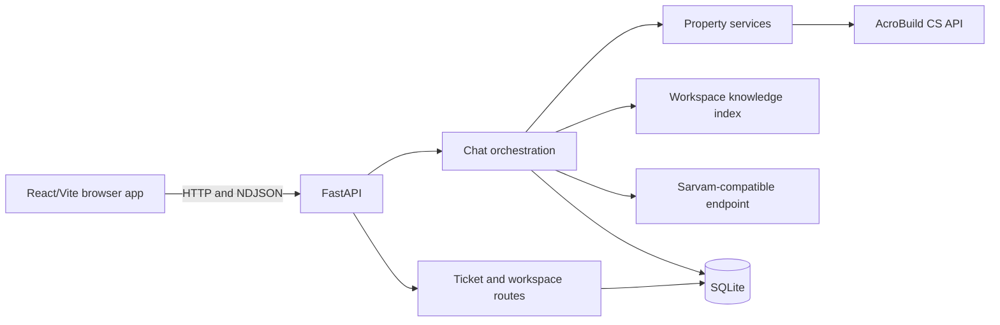

# Architecture

This document is the current system map. Use source code as the authority for
exact request and response shapes.

## System overview

The root `src/` application serves both the public customer experience and the
authenticated staff workspace. Vite proxies API calls to the FastAPI backend.
`api_context.py` creates the application and shared request models; `app.py`
registers the route modules.

## Backend boundaries

| Area | Primary code | Responsibility |
| --- | --- | --- |
| Application assembly | `api_context.py`, `app.py` | FastAPI lifecycle, middleware, shared dependencies, router registration |
| Customer chat | `routers/assist.py`, `graph/main_orchestrator.py` | JSON and streaming assist endpoints, routing, post-processing, persistence |
| Property data | `services/acrobuild_company_service.py` | Company-scoped CS API client, per-turn memoization, optional snapshot fallback |
| Property tools | `services/property_tools_service.py` | Typed, exception-safe reads and explicit blocked capabilities |
| Clarification | `services/property_clarification_service.py` | Live project, locality, wing, floor, flat, and home-type choices |
| Discovery | `services/discovery_slot_service.py` | Configuration → area → budget → shortlist flow |
| Conversation state | `services/conversation_store_service.py` | Cookie-scoped persisted turns and server-only state markers |
| Knowledge | `services/knowledge_index_service.py`, `services/knowledge_ingestion_service.py` | Article/document ingestion and hybrid retrieval |
| LLM | `qwen.py`, `sarvam_client.py`, `services/llm_service.py` | Compatibility facade and the supported Sarvam provider |
| Tickets | `graph/workflow.py`, `services/database_service.py` | Ticket classification, routing, persistence, and workspace records |
| Workspace | `routers/workspace.py`, `routers/knowledge.py`, `routers/automation.py` | Tickets, users, articles, tags, macros, rules, business hours, automation |
| Security | `services/request_security_service.py`, `services/session_service.py`, `services/auth_service.py` | Limits, audit events, staff sessions, role checks, CSRF enforcement |
| External CS settings | `routers/cs_api_settings.py`, `services/cs_api_settings_service.py` | Admin-only persisted connection overrides |

## HTTP surfaces

- Customer chat: `POST /api/support/assist`,
  `POST /api/support/assist/stream`, conversation history/delete, and voice
  synthesis.
- Public support actions: ticket creation, ticket messages, site-visit requests,
  customer OTP, and feedback. Individual routes have their own authentication
  and rate-limit rules; do not infer protection from the URL prefix.
- Property-flow routes: read-only project, wing, typology, and inventory views.
- Staff workspace: `/api/admin/*`, plus a small set of compatibility `/admin/*`
  routes. Middleware enforces an active workspace session, CSRF on cookie-based
  mutations, role tiers, and agent ticket ownership.
- Health: `GET /` is process reachability; `GET /api/health` reports configured
  SQLite, LLM, CS API, and knowledge-index status. Configuration status is not a
  live external dependency probe.

Inspect the relevant router for exact paths and authorization.

## Persistence and state

`services/database_service.py` owns the root-level `support_system.db` SQLite
workspace. The application lifespan initializes the schema and applies numbered
migrations. Tickets, users, content, configuration, security sessions, request
limits, audit events, and short-lived chat turns use this database.

Customer chat history is anonymous and browser-session scoped. The HttpOnly
`support_conversation_session` cookie identifies an owner; `conversation_id`
separates conversations. Visible history and server-only selection markers are
stored together, but history responses strip the markers. The store keeps at
most 60 messages with a two-hour sliding expiry.

## External dependencies

| Dependency | Used for | Configuration |
| --- | --- | --- |
| Sarvam-compatible endpoint | generative chat and turn analysis | `RUNPOD_BASE_URL`, `RUNPOD_API_KEY`, `MODEL_NAME` |
| AcroBuild CS API | current projects, typologies, wings, inventory, amenities | `ACROBUILD_CS_API_*` or admin-saved overrides |
| SMTP | customer email OTP | `SMTP_*` |
| Hugging Face/local models | optional embeddings, translation, and speech | `HF_TOKEN`/`HUGGINGFACE_TOKEN`, model settings |
| Ollama | optional Tenglish rewriting path | `OLLAMA_BASE_URL`, `GEMMA_TENGLISH_*` |
| HTTP(S) sources | administrator-triggered knowledge import | supplied through the protected workspace route |

The LLM and CS API fail independently. Property-specific facts must remain
grounded even when the generative provider is available.

## Frontend

`src/App.tsx` defines routes. `src/pages/CustomerHomePage.tsx` owns the public
chat experience; staff pages live under `src/pages/`. `src/lib/api.ts` is the
central backend client, `src/contexts/RoleContext.tsx` owns the workspace
session, and `src/lib/roleNavigation.ts` defines role-visible panels.

The frontend is a client of the backend security model. Server-side session and
authorization checks remain authoritative.

## Runtime compatibility layer

`graph/haystack_conversation_pipeline.py` normally imports the readable
implementation in `graph/haystack_conversation_pipeline_source.py`; there is no
conversation-routing bytecode fallback. The facade retains source-visible
compatibility overrides, while a small native Python adapter preserves the
historical pipeline call shape. The application no longer imports or depends on
the Haystack framework.
`services/answer_engine_service.py` is the readable JSON/stream/cache-invalidation
boundary used by orchestration. Its production-selected
`LegacyCompiledAnswerEngine` delegates to `services/ai_agent_service.py`, which
still loads a Python 3.12 bytecode runtime and wraps it with source-visible
fixes. `services/readable_answer_engine.py` now independently implements
retrieval, cache, deterministic dispatch, prompting/Sarvam generation,
confidence/handoff, and response/event assembly for Stage 4 verification. It is
not production-selected. Stage 4 completed constructed scenario coverage,
upstream contract mapping, no-legacy execution tests, and live CS API/Sarvam
checks. Historical retail/product-feed helpers are deliberately excluded while
the real-estate project catalogue remains supported. Details and verification
commands are in
[Compiled runtime](runtime/COMPILED_RUNTIME.md).

## Task-oriented source map

| Task | Start here |
| --- | --- |
| Change chat routing | `routers/assist.py`, `graph/main_orchestrator.py`, [chat flow](CHAT_FLOW.md) |
| Change answer-engine integration | `services/answer_engine_service.py`, `graph/main_orchestrator.py`, [compiled runtime](runtime/COMPILED_RUNTIME.md) |
| Change property answers | `services/acrobuild_company_service.py`, relevant property service, clarification contract in `AGENTS.md` |
| Change discovery | `services/discovery_slot_service.py`, `services/conversation_store_service.py`, discovery wiring in `routers/assist.py` |
| Change live API access | `services/acrobuild_company_service.py`, [CS API integration](integrations/CS_API.md) |
| Change tickets/workspace | relevant router, `services/database_service.py`, `graph/workflow.py` |
| Change auth/security | `api_context.py`, `routers/sessions.py`, `services/session_service.py`, security tests |
| Change frontend API shapes | `src/lib/api.ts`, `src/types.ts`, relevant page/component |
| Validate current readiness | [Product status](PRODUCT_STATUS.md), relevant tests, fresh live checks |
