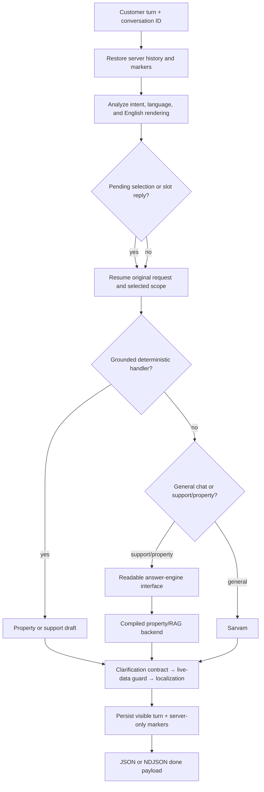
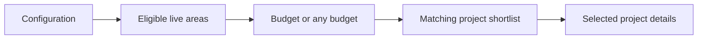

# Chat and property flow

This is the current behavioral guide for customer chat. The mandatory coding
contract is in [AGENTS.md](../AGENTS.md); source remains authoritative.

## Request path

Both assist endpoints use the same turn preparation, routing, completion, and
state-persistence rules:

- `POST /api/support/assist` returns JSON.
- `POST /api/support/assist/stream` returns NDJSON progress and a final `done`
  event with the same completed payload contract.

`graph/main_orchestrator.py::prepare_turn()` produces one analysis for the turn.
Property handlers operate on its English rendering; localization happens after
clarification and grounding checks so names, options, and numeric evidence are
not rewritten before validation.

Generative calls pass through the compatibility-named `qwen.py` facade and use
Sarvam. The LLM and CS API are independent dependencies.

Property/RAG orchestration calls `services/answer_engine_service.py` for both
JSON answers and stream events. The interface records only non-sensitive
execution metadata and currently delegates production requests to
`LegacyCompiledAnswerEngine`. Stage 4 added an independently executable
`ReadableAnswerEngine` with source-visible retrieval, cache, dispatch,
prompting/Sarvam generation, confidence/handoff, and response/event assembly.
It is available only through explicit isolated selection while representative
coverage is verified with a constructed sanitized corpus and mapped upstream
contract suites. Historical retail/product-feed behavior is intentionally
unsupported by the readable engine; real-estate project catalogue behavior is
preserved. Production still selects the legacy backend, and property stream
events still reach shared completion before any buffered answer is exposed.

## Grounding and completion order

`routers/assist.py::_complete_payload()` applies the shared clarification
contract, derives source status from the current turn's CS API trace, enforces
property grounding, adds terminal quick replies where appropriate, localizes the
answer, and attaches evaluation/trace fields.

Property facts may come only from the live CS API or an explicitly disclosed
allowed snapshot. A successful model response cannot compensate for a failed
property read. Public `data_api_calls` are sanitized; raw upstream errors remain
in server logs.

For repeated calls to the same endpoint and parameters in one turn, the latest
call determines source status. A later live success supersedes an earlier
failure; a later failure remains authoritative unless a permitted snapshot
covers that resource.

## Property clarification contract

Every project, locality, wing, floor, flat, or home-type clarification goes
through `services/property_clarification_service.py` before relevance checking,
localization, and persistence.

New answer builders set `clarification_entity`. The contract:

- obtains applicable option names from current property records;
- lists all applicable real options instead of silently choosing among matches;
- stores the original request, entity, options, selected scope, and retry query;
- preserves state through repeated transient API failures;
- lets an explicit new question or action replace stale selection state;
- gives a complete suffixed project name precedence over a contained base name;
- never derives intent by parsing translated assistant prose.

`pending_project_lookup` owns an in-progress selection. Short replies resume the
original intent, including reverse-amenity and catalogue home-type searches. A
separate `current_project` marker owns the selected project after clarification,
so a bare follow-up can stay scoped without depending on visible answer text.
Catalogue searches explicitly clear older project scope.

## Discovery memory

Discovery is implemented in `services/discovery_slot_service.py` and defaults
on. Set `ACROBUILD_DISCOVERY_SLOTS=false` to bypass all discovery code and
restore the project-first clarification path.

The server-only `discovery_slots` marker stores configuration, canonical live
locality (or `any`), maximum budget/label, awaited field, and original request.
The selected project is not duplicated there; `current_project` remains its
single source of truth.

Key rules:

- Area choices come only from locality/city fields on projects that have the
  requested configuration. The customer cannot introduce a plausible but
  unverified locality into stored state.
- Area quick replies show eligible live locality/city values followed by
  `Any area`. The wildcard is excluded from real options and the pending
  selection; customers may also type `any area` or `anywhere`.
- Budget is a free-text decision point because the live-data contract does not
  define approved budget bands. The prompt accepts a typed amount and offers
  one `Any budget` button, which applies no budget filter.
- Unknown areas are quoted back safely once and eligible live areas are offered
  again. They are not searched or persisted as valid localities.
- A budget shortlist uses estimated base amount = minimum listed per-square-foot
  rate × saleable area and states that taxes, registration, floor rise, parking,
  and rate changes are excluded. Unpriced matches stay visibly unpriced.
- A shortlist is a catalogue search and never establishes `current_project`,
  even if it contains one match. Selecting a project establishes scope and
  resumes the original home-type request.
- A live locality explicitly named with a configuration starts a catalogue
  search even when an older project is in context. A project explicitly named
  by the customer, `this project`, or a bare configuration follow-up retains the
  project-scoped behavior.
- `start over`, `reset`, `new search`, and supported clear-preference phrases
  clear discovery slots. A bare reset returns a deterministic acknowledgement;
  a reset plus a new request starts again from empty slots.
- A terminal answer's `Browse all projects` quick reply creates a new
  conversation ID in the frontend and does not inherit project, selection,
  callback, or discovery state. The initial welcome action instead sends its
  prompt through the current conversation's server assist flow.

`services/property_clarification_service.py` must not import the discovery
module; discovery already depends on the property/home-type layer. Tests enforce
this dependency direction.

## Conversation refresh

The customer page stores the active conversation ID in tab-scoped session
storage. On refresh it calls
`GET /api/support/conversations/{conversation_id}/history` with the HttpOnly
conversation cookie. The endpoint returns completed visible turns and controls,
not server markers. The browser reconciles that result with its short display
snapshot without reconstructing missing server state.

Conversation state is anonymous, browser-session scoped, limited to 60 messages,
and expires after two hours of inactivity. It is not account-level or
cross-device history.

## Terminal actions and capability limits

A terminal grounded property answer can offer **Browse all projects**, **Book a
site visit**, and **Raise a support ticket** when no clarification or existing
quick replies remain. Site visits, callbacks, and tickets are local request
workflows. They must not claim an external booking, CRM update, or confirmed
slot. Other unsupported capabilities are listed in
[Product status](PRODUCT_STATUS.md).

## Required verification for routing changes

- Cover both assist endpoints.
- Exercise named options, short selection replies, repeated property API
  failures, intent preservation, localization, and state reset where relevant.
- Verify explicit `ACROBUILD_DISCOVERY_SLOTS=false` behavior when touching
  discovery wiring.
- Run `scripts/live_disambiguation_check.py` for real property clarification;
  use `--discovery` for the Phase 1 flow.
- Never replace missing live prerequisites with invented projects, inventory,
  pricing, locality, or availability.
